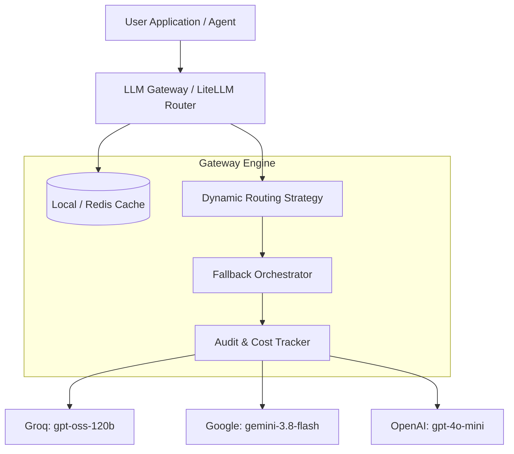

# 🌐 LLM Gateways: Production-Grade Multi-Provider Architecture

[](https://www.python.org/)
[](https://github.com/BerriAI/litellm)
[](https://www.langchain.com/)
[](LICENSE)

An end-to-end implementation of an **Enterprise LLM Gateway** pattern using **LiteLLM**, **LangChain**, **Groq**, **Google Gemini**, and **OpenAI**. 

This repository demonstrates how to break free from vendor lock-in, eliminate API downtime, slash inference costs, implement dynamic routing, and bring enterprise-grade observability and caching to production AI workflows.

---

## 📌 Table of Contents

- [Why You Need an LLM Gateway](#-why-you-need-an-llm-gateway)
- [Architecture Overview](#-architecture-overview)
- [Key Features Implemented](#-key-features-implemented)
  - [1. Unified API Interface](#1-unified-multi-provider-api)
  - [2. Automated High-Availability Fallbacks](#2-automated-high-availability-fallbacks)
  - [3. Real-Time Cost & Token Accounting](#3-real-time-cost--token-accounting)
  - [4. Zero-Cost Semantic & In-Memory Caching](#4-zero-cost-in-memory-caching)
  - [5. Intelligent Routing & Load Balancing](#5-intelligent-routing--load-balancing)
  - [6. Full Observability & Audit Logging](#6-full-observability--audit-logging)
  - [7. LangChain Expression Language (LCEL) Integration](#7-langchain-expression-language-lcel-integration)
- [Tech Stack](#-tech-stack)
- [Getting Started](#-getting-started)
  - [Prerequisites](#prerequisites)
  - [Installation](#installation)
  - [Environment Variables](#environment-variables)
  - [Running the Notebook](#running-the-notebook)
- [Detailed Code Walkthrough](#-detailed-code-walkthrough)
- [Contributing & License](#-contributing--license)

---

## 💡 Why You Need an LLM Gateway

Directly coupling application code to a single LLM provider (like OpenAI or Anthropic) introduces critical production vulnerabilities:
- **Single Point of Failure (SPOF):** Provider outages, rate limits (HTTP 429), or billing issues instantly crash downstream apps.
- **Vendor Lock-In:** Migrating between providers requires rewriting SDK calls, message formatting, and error handlers.
- **Uncontrolled Costs:** No unified cost tracking, rate limiting, or caching across teams and microservices.
- **Latency Bottlenecks:** Missing dynamic routing to select the fastest provider in real time.

An **LLM Gateway** sits as a reverse proxy/routing layer between your client applications and upstream AI model providers.



---

## 🚀 Key Features Implemented

### 1. Unified Multi-Provider API
Standardize prompt schemas and completions across providers (`groq/`, `gemini/`, `openai/`, `anthropic/`) through a single unified interface:

```python
from litellm import completion

# Call Groq, Gemini, or OpenAI with the identical syntax
response = completion(
    model="gemini/gemini-3.8-flash",
    messages=[{"role": "user", "content": "Explain RAG in one sentence."}],
)
print(response.choices[0].message.content)
```

### 2. Automated High-Availability Fallbacks
Guarantee 99.99% uptime. If a primary provider encounters rate limits, exhausted quotas, or network timeouts, the gateway seamlessly fails over to backup providers without dropping user requests.

```python
response = completion(
    model="openai/primary-model",
    messages=[{"role": "user", "content": "What is an LLM Gateway?"}],
    fallbacks=[
        "gemini/gemini-3.8-flash",     # 1st fallback
        "groq/openai/gpt-oss-120b"     # 2nd fallback
    ]
)
print(f"Rescued by: {response.model}")
```

### 3. Real-Time Cost & Token Accounting
Track exact prompt and completion token counts with down-to-the-penny USD conversion for every single request:

```python
from litellm import completion, completion_cost

response = completion(
    model="gemini/gemini-3.8-flash",
    messages=[{"role": "user", "content": "Write a haiku about AI."}]
)

cost = completion_cost(completion_response=response)
print(f"Tokens: In={response.usage.prompt_tokens}, Out={response.usage.completion_tokens}")
print(f"Exact Cost: ${cost:.8f}")
```

### 4. Zero-Cost In-Memory Caching
Identical or repetitive queries are intercepted by the cache layer, delivering sub-millisecond responses at **$0.00 cost**:

```python
import litellm
from litellm.caching import Cache

litellm.cache = Cache(type="local")

# First call hits the remote API (~1.20s)
r1 = completion(model="gemini/gemini-3.8-flash", messages=[...], caching=True)

# Second call is served from cache (~0.002s) -> 500x faster!
r2 = completion(model="gemini/gemini-3.8-flash", messages=[...], caching=True)
```

### 5. Intelligent Routing & Load Balancing
Route traffic dynamically using custom aliases and built-in production strategies:
- **`simple-shuffle`**: Distribute load across multiple deployments or API keys.
- **`least-busy`**: Send requests to the instance with the lowest active concurrency.
- **`latency-based-routing`**: Dynamically probe and direct queries to the lowest-latency model.

```python
from litellm import Router

model_list = [
    {
        "model_name": "chat",
        "litellm_params": {"model": "gemini/gemini-3.8-flash", "api_key": "..."},
        "model_info": {"id": "google-gemini"}
    },
    {
        "model_name": "chat",
        "litellm_params": {"model": "groq/openai/gpt-oss-120b", "api_key": "..."},
        "model_info": {"id": "groq-accelerator"}
    }
]

router = Router(model_list=model_list, routing_strategy="latency-based-routing")
response = router.completion(model="chat", messages=[...])
```

### 6. Full Observability & Audit Logging
Capture telemetry for every call—including timestamp, latency, token consumption, cost, and user attribution IDs (`user="harsha"`):

```python
import litellm

call_logs = []

def log_success(kwargs, completion_response, start_time, end_time):
    call_logs.append({
        "model": kwargs.get("model"),
        "user": kwargs.get("user"),
        "latency_sec": round((end_time - start_time).total_seconds(), 2),
        "tokens": completion_response.usage.total_tokens,
        "cost_usd": kwargs.get("response_cost", 0)
    })

litellm.success_callback = [log_success]
```

### 7. LangChain Expression Language (LCEL) Integration
Seamlessly connect the gateway with modern LangChain pipelines using `langchain-litellm`:

```python
from langchain_litellm import ChatLiteLLM
from langchain_core.prompts import ChatPromptTemplate
from langchain_core.output_parsers import StrOutputParser

# Create primary and fallbacks
primary = ChatLiteLLM(model="gpt-4o-mini")
backup = ChatLiteLLM(model="groq/openai/gpt-oss-120b")
robust_llm = primary.with_fallbacks([backup])

prompt = ChatPromptTemplate.from_messages([
    ("system", "You are an expert AI architect. Be concise."),
    ("user", "{question}")
])

chain = prompt | robust_llm | StrOutputParser()
answer = chain.invoke({"question": "Why is an LLM Gateway essential?"})
```

---

## 🛠 Tech Stack

- **Gateway Engine:** [LiteLLM](https://github.com/BerriAI/litellm)
- **Pipeline Orchestration:** [LangChain](https://www.langchain.com/) / `langchain-litellm`
- **Supported Providers:** Groq, Google Gemini, OpenAI, Anthropic
- **Environment Management:** [uv](https://github.com/astral-sh/uv) / Python 3.10+
- **Interactive Notebooks:** Jupyter

---

## ⚡ Getting Started

### Prerequisites
- Python 3.10 or higher
- [uv](https://docs.astral.sh/uv/) package manager (recommended) or standard `pip`

### Installation

```bash
# Clone the repository
git clone https://github.com/your-username/LLMGateways.git
cd LLMGateways

# Create virtual environment and install dependencies with uv
uv venv
source .venv/bin/activate  # On Windows: .venv\Scripts\activate
uv add -r requirements.txt
```

### Environment Variables

Create a `.env` file in the root directory:

```env
OPENAI_API_KEY="sk-..."
GROQ_API_KEY="gsk_..."
GEMINI_API_KEY="AQ...."
ANTHROPIC_API_KEY="sk-ant-..."
```

### Running the Notebook

Launch Jupyter and open the guided notebook:

```bash
jupyter notebook llmgateways/1-llmgateways.ipynb
```

---

## 📂 Project Structure

```plaintext
LLMGateways/
├── llmgateways/
│   └── 1-llmgateways.ipynb     # Step-by-step interactive gateway tutorial
├── src/
│   └── llmgateways/
│       └── __init__.py         # Package entrypoint
├── .env                        # Local API credentials (git-ignored)
├── pyproject.toml              # Project dependencies & metadata
├── requirements.txt            # Core dependencies
└── README.md                   # Project documentation
```

---

## 🤝 Contributing

Contributions, issues, and feature requests are welcome! Feel free to check the [issues page](https://github.com/your-username/LLMGateways/issues).

---

## 📄 License

This project is licensed under the MIT License - see the LICENSE file for details.
